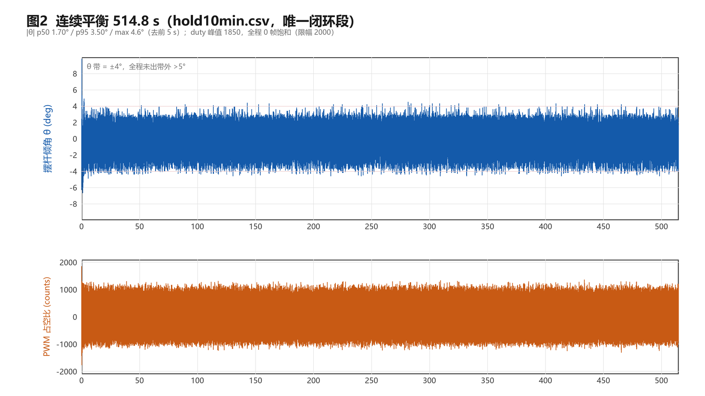
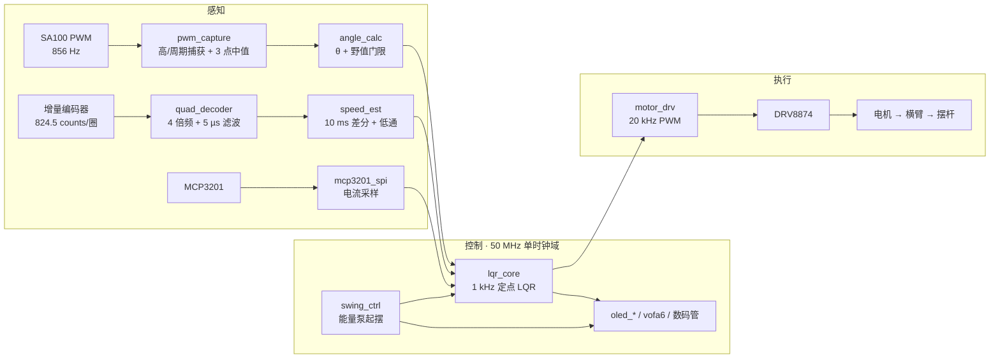

# LQR_Furuta · FPGA 旋转倒立摆

**一块高云 GW2A-18 上的旋转倒立摆（Furuta）：摆角解码、测速、LQR 控制律与 PWM 全部用 RTL 实现，没有任何 MCU 参与。**


> 2026 全国大学生嵌入式芯片与系统设计竞赛 · FPGA 创新设计赛道 · 选题一
> 「基于 FPGA 的实时姿态控制系统（旋转式倒立摆）」
>
> 定版 **v1.1**（2026-11-03，单段连续平衡 **660.1 s**），码流 CheckSum `0x2D55`
> 技术报告全文（20 页 PDF）：[docs/技术报告.pdf](docs/技术报告.pdf)

**English** — A complete rotary inverted pendulum on a Gowin GW2A-18 FPGA. PWM angle
decoding, quadrature decoding, speed estimation, a 1 kHz fixed-point LQR law, an
energy-pumping swing-up state machine and 20 kHz PWM are all synthesizable Verilog in a
single 50 MHz clock domain — no soft core, no MCU. Raw measurement CSVs and the scripts
that recompute every number in the docs are included.



---

## 1. 这是什么

| | 实现 |
|---|---|
| **感知** | SA100 角位移传感器（PWM 占空比解码，856 Hz 帧）＋ 增量编码器（4 倍频，824.5 counts/圈）＋ MCP3201 电流采样 |
| **控制** | 1 kHz 定点 LQR：θ 内环 ＋ φ 外环串级（θ̇/φ̇ 阻尼、积分、死区前馈），加能量泵起摆状态机（6 态） |
| **执行** | DRV8874 PH/EN，20 kHz PWM，占空比分辨率 2500 counts（0.04%） |
| **交互** | SH1106 OLED 三页菜单 ＋ 板载数码管 ＋ EC11 旋钮 |
| **遥测** | VOFA JustFloat 6 通道 @ 100 Hz，115200 8N1 |

**感知 → 滤波 → 控制律 → PWM 全链路 100% 在 FPGA 内完成。** 参考方案通常让摆角经外置
ADC 或 MCU 采样再转发进 FPGA，本项目没有这条外部路径。



**架构要点**

- **定点化**：角度统一用 0.1° 的定点整数，增益以 Q8 常量乘法 + 右移实现；`KDP` 直接拆成
  `(φ̇<<7) + (φ̇<<1)`（=×130），避开 1 拍内的乘法器，保 Fmax。
- **两个时基**：控制环 1 kHz（`lqr_core`），角度帧 856 Hz（SA100 更新率），采样与执行解耦，
  避免 1 kHz 硬等传感器。
- **起摆靠能量泵**：`swing_ctrl` 按 `±sign(θ̇·cosθ)` 施力把能量抬到捕获窗口，再切 LQR 平衡。
- **失败也写进文档**：`docs/04_已知问题.md` 记录了未修复的缺陷与未验证的结论（包括跟随工况
  掉摆），报告与答辩前必读。

---

## 2. 关键指标

全部数字都能从 `docs/data/` 的原始 CSV 复算：定版 campaign 用
`python tools/recompute_v30.py all`，1.0 基线用 `python tools/recompute_all.py`，
判据口径见 [docs/03_数据与复算.md](docs/03_数据与复算.md)；1.1 的改动与推导见
[VERSION_1.1.md](VERSION_1.1.md)。

### v1.1 定版（码流 `0x2D55`，2026-11-03 20:20~21:10 十段实测 S0~S10）

| 项 | 实测值 | 数据 |
|---|---|---|
| 起摆成功率 | **10/10 = 100%**（另 1 轮起点过晚、数据不足剔除） | `docs/data/v30_S2.csv` |
| 起摆耗时 | kick → 平衡 中位 **1.14 s**（1.11~1.16 s） | 同上 |
| 连续平衡 | **660.1 s** 单段不倒（11 分 00 秒，0 帧饱和） | `docs/data/v30_S4.csv` |
| 平衡精度 | \|θ\| p50 **0.70°** / p95 **1.60°** / rms **0.86°** / max 2.40° | 同上 |
| 执行器余量 | duty 峰值 **1161**（限幅 2000），mean \|duty\| 421，饱和 **0 帧** | 同上 |
| 横臂漂移 | 净 **−21 counts（−9.2°）** / 660 s ≈ **0.83 °/min** | 同上 |
| 抗瞬时推扰 | 峰值 5.0~14.1° 共 **8 次，8 次全部恢复**，恢复 0.19~1.33 s | `docs/data/v30_S6.csv` |
| 位置跟随阶跃 | 目标 +18°，实测 **+14.4°**，稳态误差 −3.6°，过冲 26° 后回落 | `docs/data/v30_S7b.csv` |
| 正弦轨迹跟踪 | 0.245 Hz / 35° → ±26.6°（**76%**）；0.351 Hz / 50° → ±33.8°（**68%**） | `v30_S9.csv` `v30_S10.csv` |
| SA100 静止噪声 | ±0.25°（1σ 0.06°，60 s 内只有 6 个码值） | `docs/data/v30_S0b2.csv` |

改了什么：`KDT` 60 → 120，θ̇ 一阶低通 `>>>3`（8 ms）→ `>>>1`（2 ms），把 5 Hz 极限环
的动能从 96% 压到约 3%，抖动主频由 5.1 Hz 移到 8.0 Hz。推导与陷波回退实验见
[VERSION_1.1.md](VERSION_1.1.md)。

### v1.0 基线（码流 `0x6A6F`，历史数据）

| 项 | 值 | 数据 |
|---|---|---|
| 起摆成功率 | 83%（15/18 站住 ≥2 s；17/18 完成捕获） | `docs/data/swing10.csv` |
| 起摆耗时 | kick → 平衡 中位 1.14 s（1.10–1.77 s） | 同上 |
| 连续平衡 | 514.8 s 单段不倒 | `docs/data/hold10min.csv` |
| 平衡精度 | \|θ\| p50 1.70° / p95 3.50° / rms 2.03° / max 4.90° | 同上 |
| 执行器余量 | duty 饱和 0 帧，mean \|duty\| 508，峰值 1850（限幅 2000） | 同上 |
| 横臂漂移 | 净 33.6° / 8.6 min ≈ 3.9 °/min | 同上 |
| 抗瞬时推扰 | 检出 35 次，33 次自行恢复（94%），可恢复峰值 26.7°，掉摆 2 次 | `docs/data/disturb3.csv` |

> ⚠️ **口径提醒**：两套数据的判据不同——1.1 的抗扰按 `|θ| ≥ 4.5°` 起判、2 s 内合并，
> 1.0 按 `|θ| ≥ 8°`、0.3 s 内合并。跨版本比较时请标注"v1.0 数据 / 1.1 数据"，
> 不要拼成同一条曲线。上面那张图是 v1.0 的 514.8 s 段，定版 660 s 段的图见技术报告。

---

## 3. 资源与时序（GW2A-LV18PG256C8/I7）

| 资源 | 用量 | 占比 |
|---|---|---|
| Logic | 13081 / 20736 | 64% |
| Register | 3644 / 16173 | 23% |
| **CLS** | **7550 / 10368** | **73%（真正的瓶颈）** |
| BSRAM | 18 / 46 | 40% |
| DSP | 11 / 24 | 46% |
| I/O | 27 / 207 | 14% |

| 时序 | v1.1 | v1.0 |
|---|---|---|
| 约束 | 50 MHz | 50 MHz |
| 实际 Fmax | **50.022 MHz** | 50.008 MHz |
| TNS（setup / hold） | 0.000 / 0.000 | 0.000 / 0.000 |
| 最差 setup slack | **+0.009 ns** | +0.003 ns |

> ⚠️ 时序余量只有几皮秒，属于"过线"而不是"有余量"。改动任何 OLED 相关逻辑前请先看
> [docs/04_已知问题.md](docs/04_已知问题.md) A-2。

---

## 4. 仓库结构

```text
LQR_Furuta/
├── README.md                 本文件
├── LICENSE                   MIT
├── LQR_end.gprj              Gowin 工程（顶层 bal_top）
├── build.tcl                 命令行全流程构建脚本（UTF-8 无 BOM）
├── VERSION_1.1.md            1.1 的改动、实测与回滚
├── src/                      36 个 Verilog，5465 行
│   ├── bal_top.v             ★ 顶层：数据通路 / 模式 / 跟随 / 正弦 / 数码管
│   ├── lqr_core.v            ★ 1 kHz LQR 内核
│   ├── swing_ctrl.v          ★ 起摆状态机（6 态）
│   ├── angle_calc.v          SA100 PWM → 角度（野值门限 JUMP_MAX=40）
│   ├── pwm_capture.v         高电平/周期捕获 + 3 点中值
│   ├── quad_decoder.v        编码器 4 倍频 + 5 µs 数字滤波
│   ├── speed_est.v           10 ms 差分测速 + 一阶低通
│   ├── sin_gen.v / sin_lut.v 正弦轨迹（256 点表 + 线性插值）
│   ├── oled_*.v / sh1106_i2c.v / *_rom.v / *.mem   OLED 三条显示路径
│   ├── mcp3201_spi.v / motor_drv.v / vofa6.v / uart_*.v
│   └── LQR_end.cst / LQR_end.sdc                  引脚与时序约束
├── docs/
│   ├── 01_算法说明.md        ★ 数据通路、LQR、起摆、跟随、正弦逐条说明
│   ├── 02_测试清单与数据记录.md   赛题要求逐项对照 + 实测表
│   ├── 03_数据与复算.md       CSV 字段、判据口径、复算命令
│   ├── 04_已知问题.md        ★ 已知缺陷与未验证事项（写报告必读）
│   ├── 05_编码约定.md         文件编码规范（避免乱码）
│   ├── data/                 实测原始 CSV（v30 定版 14 个 + 1.0 历史 5 个）
│   ├── figures/              报告用图（由 tools/plot_measured.py 生成）
│   └── 技术报告.pdf           ★ 20 页技术报告（引 v1.1 定版数据）
├── evidence/                 综合/时序/资源报告、改名重建复验记录
├── firmware/
│   ├── LQR_end1.1_0x2D55.fs  ★ 当前定版码流
│   ├── history/LQR_end_1.0_0x6A6F.fs   上一版，回滚用
│   └── README.md             码流说明与烧写方法
├── sim/                      定点闭环模型（**当前有 bug**，见 docs/04 C-2）
└── tools/                    抓包、复算、画图、编码整理、链接检查
```

`impl/`（综合与布局布线产物）不入库，`build.tcl` 可从 `src/` 完整重建；两个 `.fs` 码流
**故意入库**，评审时不用装工具链也能直接烧板。

---

## 5. 快速开始

### 5.1 需要什么

- **硬件**：GW2A-LV18PG256C8/I7 开发板、SA100 角位移传感器、增量编码器、DRV8874 驱动板、
  MCP3201、SH1106 OLED、EC11 旋钮。
- **工具链**：Gowin EDA **V1.9.12.04 x64**（其他版本未验证）。
- **数据脚本**：Python 3.9+，`pip install -r requirements.txt`（numpy / pandas / Pillow）。

### 5.2 编译

```powershell
# 在仓库根目录（含 LQR_end.gprj 的那一层）执行
$env:GOWIN_HOME = 'C:\Gowin\Gowin_V1.9.12.04_x64'   # 改成你的安装路径

& "$env:GOWIN_HOME\IDE\bin\gw_sh.exe" build.tcl
# 期望输出：GowinSynthesis finish → Bitstream generation completed
#           impl/pnr/LQR_end.fs，头注释 CheckSum 应为 0x2D55
```

> `build.tcl` 必须保持 **UTF-8 无 BOM**。带 BOM 时 `gw_sh` 会报
> `invalid command name "??pen_project"`，原因见 [docs/05_编码约定.md](docs/05_编码约定.md)。

### 5.3 烧写

```powershell
& "$env:GOWIN_HOME\Programmer\bin\programmer_cli.exe" `
    --device GW2A-18C --cable "Gowin USB Cable(FT2CH)" --run 2 `
    --fsFile ".\firmware\LQR_end1.1_0x2D55.fs"
# 成功标志：Status Code is: 0x00006020 + Finished.
```

也可以直接用 Gowin Programmer GUI 打开 `firmware/` 下的 `.fs`。

### 5.4 复算与出图

```powershell
python tools/recompute_all.py     # 重算 docs/ 里出现的每一个实测数字
python tools/recompute_v30.py all # 复算定版 campaign（docs/data/v30_S*.csv）
python tools/plot_measured.py     # 重画 docs/figures/
python tools/check_links.py       # 检查所有 Markdown 相对链接是否有效
```

`recompute_all.py` 是"数字可复算"的唯一入口：文档与数据脱节时它会直接对不上。

---

## 6. 操作说明

| 操作 | 行为 |
|---|---|
| `F10` 复位 | 全系统复位 |
| `D11` 短按 | 启动/停止（`run`）——启动后自动起摆，捕获即进平衡 |
| `D11` 长按 | 编码器计数清零（横臂位置归零） |
| 旋钮转动 | 主菜单切换图标；参数页滚动；轨迹页调目标；跟随中每格 ±18° |
| 旋钮短按 | 选中：参数页 / 轨迹页 / 跟随 / 正弦档位 |
| 旋钮长按 | 返回主菜单 / 退出参数页 |
| 串口发 `i` | 起摆泵能方向取反（在线 A/B，不用重烧） |

**数码管状态**：`0` 停 / `1` 起摆中 / `2` 平衡中 / `3` 轨迹页已选中 / `8` 故障（ADC 过流锁存）

---

## 7. 版本链

```text
LQR_2.1（起摆 + LQR 雏形）
  → 3.0i（KDP130 + 双 3 点中值 + JUMP_MAX 40，定版控制）
  → 4.0（+数码管 +轨迹页）→ 5.0（+旋钮跟随）
  → 6.0（跟随 + 野值爆发保持）→ 8.0（速度页 / 幅度档）
  → 9.0（跟随软着陆 / 光标修复）→ 10.0（多轮滤波与增益微调）
  → 11.0（正弦基准 sin_base + 轨迹页精简）
  → LQR_end 1.0（0x6A6F：改名 + 文档/数据/算法说明同步）
  → LQR_end 1.1（0x2D55：KDT 120 + θ̇ 低通 2 ms，压掉 5 Hz 极限环）★ 当前定版
```

按 **CheckSum** 识别版本：`0x2D55` = 当前定版，`0x6A6F` = 上一版。
`UserCode` 是构建校验和而不是版本号，别拿它当版本标识。

---

## 8. 已知问题

本工程有一批**已定位但未修复**的问题，以及若干**推断尚未实测**的结论，全部写在
[docs/04_已知问题.md](docs/04_已知问题.md)。写报告、答辩前请先读。最重要的三条：

1. **跟随工况（拓展要求③）会掉摆**，机理是推断而非实测——遥测里没有 `phi_tgt` 通道。
2. **时序余量只有 9 ps**，改任何 OLED 相关逻辑都可能违例。
3. **`sim/` 的定点模型当前跑不起来**，不能当回归工具用（C-2）。

---

## 9. 许可与引用

- 代码与文档：[MIT License](LICENSE)。可自由使用、修改、再分发，保留版权声明即可。
- 码流由 Gowin EDA 生成，工具本身不随仓库分发；复现需要自备 Gowin 授权。
- 若在报告、论文或答辩中引用本项目，请注明仓库地址与版本（`v1.1 / 0x2D55`）。
- 数据（`docs/data/*.csv`）为本项目实测原始记录，同样以 MIT 授权，欢迎用于复现与对比。

---

## 10. 致谢

- 高云半导体 GW2A 系列器件与 Gowin EDA。
- VOFA+ 的 JustFloat 协议（仅使用帧格式，未分发其代码）。
- 感谢调试期间提供测量与复核帮助的同学与指导老师。
